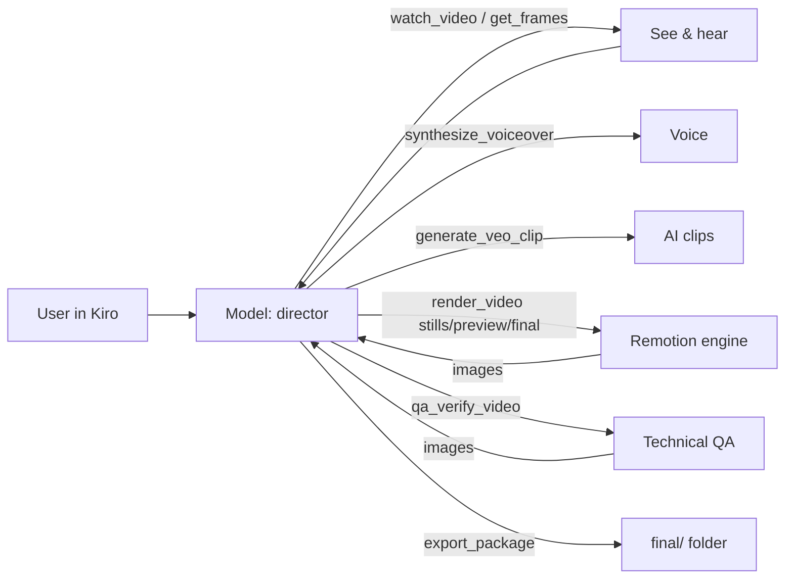

# Design — ARGUS v2

## 1. Roles



The model decides everything creative. Tools return material the model can perceive
(images, timecodes, words, sound events) and do mechanics. The only deterministic
"judgement" in code is technical QA (§11).

## 2. Tool surface (17 tools)

| Tool | Status | Purpose |
|---|---|---|
| `studio_guide()` | new, replaces `story_guide` | guide + capabilities + user preferences (§14) |
| `watch_video(path, project, max_frames=24, transcript=True, language=None, page=1)` | new, replaces `analyze_reference` | shots, contact sheets, words, sound events (§6) |
| `get_frames(path, times, crop=None, max_side=1024)` | new | exact frames as images, ≤ 8 per call (§6) |
| `voice_options(language=None, gender=None, query=None, limit=10)` | update | own + library voices, providers (§7) |
| `synthesize_voiceover(text, project, provider=None, voice=None, model=None, name="voice", settings=None)` | update | audio + words.json (§7) |
| `generate_veo_clip(...)` | keep | unchanged signature |
| `flow_login()` | keep | unchanged |
| `render_video(plan, project, mode="final", times=None, compare=None, format=None, name=None)` | new, replaces `build_kinetic_video`, `assemble_master_video`, `build_pop_subtitles` | stills / preview / final (§9) |
| `job_status(job_id)` | new | state, progress, result (§5) |
| `qa_verify_video(video_path, format=None, frames=4)` | update | technical checks + images (§11) |
| `export_package(project, videos, texts, cover_times=None, name=None)` | new | final folder (§12) |
| `calculate_beat_grid(audio_path, snap_times=None)` | keep | music beats |
| `search_sfx(...)`, `download_sfx(...)` | keep | Freesound CC0 |
| `learn_and_record_memory(lesson_title, user_directive, technical_rule)` | keep, docstring changes | lasting user preferences (§14) |
| `run_script(name=None, args=None, timeout_s=120)` | new | user scripts (§13) |
| `doctor(check_flow=False)` | update | environment check (§15) |

Removed: `analyze_reference`, `story_guide`, `validate_beats`, `build_kinetic_video`,
`assemble_master_video`, `build_pop_subtitles`, `calculate_acoustic_timeline` (§16).

### Server instructions (replace the current `instructions=` text in `server.py`)

> ARGUS turns you into a video editor and producer for TikTok, Shorts and YouTube.
> Call `studio_guide` at the start of every session: it holds the working method and
> the user's saved preferences. You make every creative decision. ARGUS tools watch
> (`watch_video`, `get_frames`), speak (`synthesize_voiceover`), generate
> (`generate_veo_clip`), render (`render_video`), check (`qa_verify_video`) and package
> (`export_package`). Operations that take long return a `job_id`; poll `job_status`.

## 3. Project folder

`argus.project.project_dir(name) -> Path` resolves `OMNIFRAME_OUTPUT_DIR/projects/<slug>`
(slug: `[a-z0-9-]{1,48}`, derived from the name) and creates:

```
<project>/
  refs/          user references and footage copies (optional; tools accept any path)
  audio/         voice files + *.words.json, music, sfx
  components/    custom .tsx components written by the model
  cache/         watch results, proxies (kept between sessions)
  renders/       stills, previews, final renders
  final/         export_package output
  .work/         temporary; removed by export_package
  plan.json      last plan rendered in final mode (for "do it like last time")
```

## 4. Images to the model

`src/argus/media_out.py`:

- `prepare_image(path, max_side=1024, quality=85) -> Path` — Pillow downscale to JPEG
  next to the source (`*.view.jpg`), reused when newer than the source.
- `tool_result(summary: dict, images: list[Path]) -> list` — returns
  `[json.dumps(summary, ensure_ascii=False), Image(path=p1), ...]` using
  `mcp.server.mcpserver.utilities.types.Image` (fallback import from
  `mcp.server.fastmcp` for mcp 1.x, same as `server.py`). The summary always includes
  `"images": [{"t": ..., "path": ...}]` in the same order.
- Task 4 must confirm with a manual call from Kiro that images reach the model. If they
  do not, keep the list return (other clients use it) and add a guide line telling the
  model to open the listed paths with its file-reading tool.

## 5. Jobs

`src/argus/jobs.py`, generalised from the detached worker in `tools/assemble.py`:

- Job dir: `OMNIFRAME_OUTPUT_DIR/.jobs/<job_id>/` with `job.json` (kind, payload, key),
  `status.json` (`state`, `progress` 0..1 or null, `started`, `finished`, `pid`,
  `result`, `error`), `log.txt` (stderr tail).
- `start(kind, payload, key) -> job_id`: single-flight by `key` (hash of kind + payload);
  stale detection by pid liveness (`os.kill(pid, 0)`) and age, as in `assemble.py`.
- Worker: `python -I -m argus.jobs <job_dir>` (Windows `CREATE_NO_WINDOW`); dispatches
  `kind` to a registered function (`watch`, `render`, `transcribe`), writes progress
  through `report(progress, note)`.
- `run_or_detach(kind, payload, key, wait_s=20)`: starts the job, polls status until
  `wait_s`; returns the result inline when done, else `{"job_id", "state", "note"}`.
- `job_status(job_id)` tool returns status; when the result contains images, returns
  them through `tool_result`.
- Jobs older than 7 days are deleted on server start.

## 6. Watching: `watch_video` and `get_frames`

`src/argus/tools/watch.py` (replaces `tools/reference.py`).

Pipeline for one file:
1. Content hash: sha256 of the first and last 8 MB + size → cache key. Cache dir
   `<project>/cache/watch/<key>/`. Cache hit → return stored `watch.json`.
2. Probe with `ffmpeg.stream_info`.
3. Shots: one ffmpeg pass on a downscaled stream at full fps:
   `-vf "scale=320:-2,select='gt(scene,0.30)',showinfo" -f null -`, parse `pts_time`.
   Threshold is a module constant (technical detector setting, not a creative rule).
4. Frame selection within `max_frames`: start of every shot (+0.15 s), plus a middle
   frame for shots longer than 6 s; if over budget keep first/last shot and spread the
   rest evenly over the timeline. Always include t≈0.5 s (the hook).
5. Extract frames with `ffmpeg -ss t -i src -frames:v 1` (full res) into the cache dir.
6. Contact sheets: Pillow grid of 6 tiles (2×3 for 9:16, 3×2 for 16:9), each tile
   labelled `mm:ss.s` and shot index; long side ≤ 1600 px. Page = one sheet;
   `page` selects which sheets are returned (default first 2 sheets per call).
7. Transcript (when `transcript=True` and faster-whisper importable): reuse the proven
   approach from `skills/montazh-epizod/scripts/speech.py` (decode to 16 kHz mono numpy
   to avoid the PyAV issue, `word_timestamps=True`, `vad_filter=True`,
   `condition_on_previous_text=False`, `temperature=0`; verbatim `initial_prompt` only
   for Russian). Model size from `ARGUS_WHISPER_MODEL` (default `small`, `int8`, CPU).
   Save `words.json` (`[{w,s,e}]`) and `segments.json`.
8. Sound events: reuse `_decode_mono` and `_onset_envelope` from `tools/beats.py`;
   peak-pick onsets above a fixed relative strength; return `[{t, strength}]` (cap 200).
9. Return `tool_result(summary, sheets_for_page)`.

Summary: `{duration, width, height, fps, shots:[[s,e],...], frames:[{t, path, shot}],
sheets_total, page, words_path, language, segments:[{s,e,text}] (all), sound_events,
cache_hit}`.

Runs through `run_or_detach("watch", ...)` (transcription of long files takes minutes).
Multiple files: the model calls `watch_video` once per file.

`get_frames(path, times, crop, max_side)`: ≤ 8 times; `crop=[x, y, w, h]` fractions;
frames saved to `<project or output>/.work/frames/`; returns images.

## 7. Voice

`src/argus/tools/voiceover.py` keeps the public names; internals become providers:

```python
class VoiceProvider(Protocol):
    name: str
    def available(self) -> bool: ...
    def synthesize(self, text: str, voice: str | None, model: str | None,
                   settings: dict | None, out_audio: Path) -> list[dict] | None: ...
        # returns word timings [{w,s,e}] or None
```

Providers: `elevenlabs` (default when key set), `gemini`, `edge` (default without keys).
A future `voicestudio` provider plugs in the same way.

ElevenLabs (verify ids and fields in the official docs during the task):
- Endpoint: `POST /v1/text-to-speech/{voice_id}/with-timestamps` → base64 audio +
  character `alignment`; convert characters to words (split on whitespace, take first
  char start / last char end). Strip audio tags like `[whispers]` from the words list.
- Default model `ARGUS_ELEVEN_MODEL` = `eleven_v3` (check `GET /v1/models` for the current
  id and whether timestamps are supported; fallback: ElevenLabs forced alignment
  endpoint, then faster-whisper).
- Pauses and emotion: v3 uses audio tags (`[pause]`, `[whispers]`, `[excited]`…); SSML
  `<break>` works only on v2/turbo models. The tool passes the text unchanged.
- Long text: split on paragraph boundaries (≤ the model's character limit), synthesize
  in order, concatenate audio with ffmpeg, offset word timings.
- `voice_options`: `GET /v1/voices` (own) and `GET /v1/shared-voices` with
  `language/gender/search/page_size` filters. If a library voice must be added to the
  account before use, `synthesize_voiceover` adds it automatically and says so.

edge-tts: stream `Communicate(...)`, collect `WordBoundary` events (offset/duration in
100-ns units) → words. Default voice by language (`ru-RU-DmitryNeural`, `en-US-GuyNeural`, …).

Gemini: as today; no timestamps → faster-whisper alignment when installed.

Output: `<project>/audio/<name>.mp3` (mastering chain from v1 kept: highpass, EQ,
compressor, loudnorm) and `<project>/audio/<name>.words.json`. Return
`{audio, words_path, duration, provider, voice, model, words_source}`.

## 8. Plan v2

Python source of truth: `src/argus/plan.py` (pydantic v2 models, `extra="forbid"` so typos
are reported). TypeScript mirror: `engine/src/types.ts`.

```ts
type Plan = {
  version: 2;
  format: '9:16' | '16:9';          // 1080x1920 | 1920x1080
  fps?: 24 | 25 | 30 | 50 | 60;     // default 30
  duration?: number;                // seconds; derived when absent
  style: StyleTokens | 'dark' | 'light';
  clips?: Clip[];                   // video/image track
  scenes?: Scene[];                 // built-in kinds + 'custom'
  hud?: HudOverlay;                 // existing shape
  captions?: Captions;
  audio?: {voice?: AudioRef; music?: Music; sfx?: SfxEvent[]};
};

type StyleTokens = {
  colors: {bg: string; text: string; muted: string; accent: string; [name: string]: string};
  fonts: {display: FontRef; body: FontRef; mono?: FontRef};
  text_scale?: number;              // multiplies all text sizes, default 1
  safe_area?: {top: number; bottom: number; left: number; right: number}; // fractions
  background?: {type: 'solid'} | {type: 'gradient'; stops: string[]; angle?: number}
             | {type: 'media'; src: string; fit?: 'cover' | 'contain'};
  grain?: number;                   // 0..1 opacity, default from preset
  vignette?: boolean;
};
type FontRef = {family: string; src?: string; weight?: number}; // src = project font file

type Clip = {
  src: string; at: number; in?: number; out?: number;   // seconds
  fit?: 'cover' | 'contain'; volume?: number; muted?: boolean;
  zoom?: {t: number; scale: number; x?: number; y?: number; ease?: 'linear'|'inOut'}[];
  clean_audio?: boolean;
};

// Every scene gets: until?: number (default: next full scene's at), overlay?: boolean
// (transparent background, drawn above clips). Existing kinds keep their fields.
type CustomScene = {kind: 'custom'; at: number; until?: number; overlay?: boolean;
                    component: string; props?: Record<string, unknown>};

type Captions = {
  words: string | WordTiming[] | {source: string; remap: 'clips'};
  mode: 'word' | 'phrase';
  position?: 'upper' | 'center' | 'lower';
  style?: {font?: 'display' | 'body'; size?: number; color?: string;
           active_color?: string; upcoming_color?: string;
           outline?: number; shadow?: number; plate?: string};
  accent_words?: string[];          // exact, "prefix*" or "*"
};
type Music = {src: string; volume?: number; duck?: number; fade_in?: number; fade_out?: number};
```

Presets `dark`/`light` expand to tokens equal to today's `getTheme()` values.
Safe-area defaults: 9:16 `{top: .08, bottom: .20, left: .06, right: .12}` (platform UI),
16:9 `{top: .06, bottom: .08, left: .05, right: .05}`.

Duration when absent: max of last clip end, last scene `at`+2, HUD `until`, voice
duration, last word end; plus 0.6 s tail.

Validation errors: list of `"scenes[3].kind: unknown kind 'stamp' (expected …)"`;
returned by `render_video` without rendering.

## 9. Render pipeline

`src/argus/tools/render.py` (replaces `tools/kinetic.py`), node side
`engine/scripts/render.mjs` using `@remotion/bundler` + `@remotion/renderer` (add to
`engine/package.json`, pinned to the same version as `remotion`).

Steps (inside a `render` job; stills also run as a job with `wait_s` large enough to
usually return inline):
1. Validate plan (§8). Apply `format` override if given.
2. Captions preprocessing in Python (`src/argus/captions.py`, moved from
   `tools/subtitles.py`): load words, `clean_word_timings`, remap to output time when
   `remap: 'clips'` (for each clip from the transcript's source, keep words inside
   `[in, out]`, shift by `at - in`), `group_phrases` for phrase mode. Result is written
   into props as explicit lines/words.
3. Public dir `<project>/.work/render-<id>/public/`: engine fonts, plan font files,
   media (hardlink with `os.link`, copy if another drive), audio, SFX files.
4. Media prep: ffprobe each video clip; if VFR (`r_frame_rate != avg_frame_rate`) or not
   H.264, or `clean_audio`, make a proxy `<project>/cache/proxies/<hash>.mp4`
   (`libx264 -crf 18 -r <plan fps>`, audio `aac`; clean chain `highpass=f=80,afftdn`).
5. Custom components: copy `<project>/components/*.tsx` into `engine/src/custom/job/`,
   write `engine/src/custom/registry.ts` mapping names → default exports, typecheck with a
   temporary tsconfig that includes them; errors go back to the model. Engine lock file
   `engine/.render.lock` so only one render uses the engine dir at a time. `finally`:
   restore the committed empty `registry.ts`, delete `custom/job/`.
6. `node engine/scripts/render.mjs <job_dir>`: bundle once; `selectComposition`
   (`calculateMetadata` sets width/height/fps/duration from props); then
   - stills: `renderStill` per time → PNG → JPEG; with `compare`
     (`{"video": path, "times": [...]}` same length as `times`), Python builds
     side-by-side images (reference left, render right, labels) with Pillow;
   - preview: `renderMedia` `scale: 0.5`, `crf: 28`;
   - final: `renderMedia` full size, `crf: 18`, then ffmpeg post: `loudnorm`
     (I=-14, TP=-1.5, LRA=11), `+faststart`, `comment=Made with ARGUS Studio vX`.
   Progress from `onProgress` → job status. Concurrency from `ARGUS_RENDER_CONCURRENCY`
   (default: half the CPU cores, min 1). Browser: keep `_find_browser()` logic.
7. Outputs: `<project>/renders/<name>-<mode>-<format>.mp4` / stills JPEGs; final mode also
   saves the plan to `<project>/plan.json`. Delete `.work/render-<id>` on success.

Engine changes (`engine/src`):
- `Root.tsx`: `calculateMetadata` returns `width/height` from `format`.
- `theme.ts` → `style.ts`: `resolveStyle(plan.style)`, `StyleContext` + `useStyle()`,
  font loading for bundled Inter and plan fonts.
- `scenes.tsx`, `hud.tsx`, `text.tsx`: replace every hardcoded size (`1080 * 0.9`,
  `fontSize: 118`, `height: 1150`, …) with values relative to the frame's short side
  times `text_scale`, inside the safe area. Visual output for `9:16` + `dark` must stay
  close to v1 (compare stills before/after).
- New: `clips.tsx` (`OffthreadVideo` / `Img`, `Sequence` from `at`, `startFrom`/`endAt`
  from in/out, zoom keyframes via `interpolate`), `captions.tsx` (word and phrase modes,
  colors from tokens), `audio.tsx` (voice, music with ducking: volume multiplied by
  `duck` while inside speech windows built from caption words, 0.25 s ramps), custom
  scene renderer from the registry.
- `sfx.ts`: remove `buildSfxTimeline` auto events; play `audio.sfx` only.

## 10. Footage editing (scenario 2)

No separate tool. The model:
1. `watch_video(footage, project)` → shots, sheets, verbatim words.
2. Decides kept ranges from the words (stumbles, repeats, long pauses) and checks
   boundary frames with `get_frames`.
3. Writes a plan: `clips` from the footage with `in/out` laid back to back, zoom keyframes
   on key phrases, overlay scenes or custom components for graphics, b-roll clips,
   `captions: {words: {source: <words_path>, remap: 'clips'}}`, music with `duck`.
4. Stills → final → QA → export.

The guide (§14) describes this flow.

## 11. Technical QA

`src/argus/tools/qa.py`, format-aware:

| Check | Method | Severity |
|---|---|---|
| resolution matches format (or plan) | ffprobe | hard |
| fps in accepted set | ffprobe | hard |
| progressive scan | ffprobe | hard |
| audio present | ffprobe | hard |
| integrated loudness -14 ±1.5 LU | `loudnorm` print | hard |
| true peak ≤ -1.0 dBTP | `loudnorm` print | hard |
| \|video − audio\| ≤ 0.5 s | stream durations | hard |
| black gap ≥ 1.0 s not at the very start/end | `blackdetect=d=0.5:pix_th=0.10` | hard; 0.5–1.0 s warning |
| frozen video ≥ 3 s | `freezedetect=n=-60dB:d=3` | warning (graphics may hold) |
| silence ≥ 2 s mid-video | `silencedetect=n=-45dB:d=2` | warning |
| duration vs platform target (`target="tiktok"/"shorts"/"youtube"`) | duration | warning |

Return `{passed, hard_failures, warnings, checks, duration}` + images: `frames` evenly
spread plus one frame per black/freeze issue (cap 8).

## 12. Export

`src/argus/tools/export.py`:
- `videos`: `{"9:16": path, "16:9": path}` (one or both).
- `texts`: `{"tiktok": {"caption", "hashtags"}, "shorts": {"title", "description",
  "hashtags"}, "youtube": {"title", "description", "tags"}}` — written by the model.
- Limits in one constant table with source URLs (verify: YouTube title 100 chars,
  description 5000 chars; TikTok caption limit — check current value).
- Writes `<project>/final/<slug>_9x16.mp4` / `_16x9.mp4` (copy, `+faststart`), covers
  (`cover_times` per format or the first frame of the strongest QA frame; 9:16 cover
  1080×1920 JPEG, 16:9 thumbnail 1280×720 JPEG < 2 MB), `post.md`.
- Runs QA on each video; refuses to export when QA has hard failures (returns them).
- Removes `<project>/.work/`. Returns paths + cover images.

## 13. User scripts

`src/argus/tools/scripts_runner.py`:
- Folders: `<repo>/scripts/` and `ARGUS_SCRIPTS_DIR` (default `~/.argus/scripts`).
- Contract: a `.py` file whose module docstring starts with a one-line summary and has a
  line `Args: {json example}`; it reads one argument (path to a JSON file with args) and
  prints its result as JSON on the last stdout line. Result may include
  `"images": [paths]`.
- Name validated by `^[a-z0-9_]{1,40}$`; resolved only inside the two folders.
- Run: `[sys.executable, script, args_json]`, cwd = project dir when `args.project` is
  set, else output dir; timeout `timeout_s`; returns result or stderr tail.
- Ship `scripts/README.md` and `scripts/frame_stats.py` (example: mean color and
  brightness of given frames) used by tests. The demo task adds `scripts/screen_record.py`.

## 14. Studio guide and memory

- `src/argus/STUDIO_GUIDE.md` is the guide (first written by the planner). The spec folder
  holds only a pointer to it (20.9 item 3); edit the `src/` copy.
- `studio_guide()` returns `{guide, capabilities: {tools: [...], providers: {...}},
  preferences}`; preferences = knowledge-base file content, last ~4000 characters.
- `learn_and_record_memory`: same file format; docstring tells the model to record only
  lasting user preferences and corrections, never per-iteration tweaks.
- The old local `KNOWLEDGE_BASE.md` (v1 lessons for weaker models) is renamed to
  `KNOWLEDGE_BASE.old.md` once; a new file starts with `# ARGUS — user preferences`.

## 15. Config, doctor, keyless path

- `config._load_dotenv()`: `ARGUS_ENV_FILE` if set, else `./.env`, else
  `<repo>/.env` (`Path(__file__).resolve().parents[2]`).
- `ArgusConfig`: drop fixed `width/height` use in tools (format decides); keep `fps`,
  `loudness_target`; add `whisper_model`, `eleven_model`, `render_concurrency`,
  `scripts_dir`.
- `doctor`: critical — python, ffmpeg, ffprobe, node, npx, engine (`node_modules`,
  `@remotion/renderer`), numpy, Pillow, output dir. Optional (warn) — faster-whisper,
  edge-tts, playwright, Gemini key, ElevenLabs key. Remove the libass check after ASS
  subtitles are gone.
- Kiro MCP config `.kiro/settings/mcp.json` (verify field names in Kiro docs):
  `{"mcpServers": {"argus": {"command": ".venv/Scripts/python.exe", "args": ["-m", "argus"]}}}`
  plus macOS/Linux variant in `examples/mcp-config.example.json`.
- Sample media: `examples/media/talk_sample.mp4` (author records ~20 s of himself, owns
  rights) and `examples/plans/*.json`; `.gitignore` gets `!examples/media/*.mp4`.

## 16. Removal map

| Remove | Replaced by | When |
|---|---|---|
| `validate_beats`, `detect_genre`, slop lists, `story_guide`, `STORY_GUIDE.md`, `tests/test_reference.py` | model judgement, `studio_guide` | task 2 |
| `analyze_reference` (`tools/reference.py`) | `watch_video` | task 5 |
| `build_kinetic_video` (`tools/kinetic.py`) | `render_video` | task 18 |
| `assemble_master_video` (`tools/assemble.py`) | clips track in `render_video` | task 18 |
| `build_pop_subtitles` (`tools/subtitles.py`, ASS) | `captions` in plan; helpers moved to `captions.py` | task 18 |
| `calculate_acoustic_timeline` (`tools/timeline.py`) | word timings from voice/transcript | task 18 |
| `src/argus/fonts/` (ASS fonts) | engine fonts / plan fonts | task 18 |
| auto SFX in `engine/src/sfx.ts` | explicit `audio.sfx` | task 9 |
| 30% sections in `STARTER.md`, `skills/montazh-mani/SKILL.md`, `skills/montazh-esse/SKILL.md` | — | task 2 |

## 17. Testing

- Unit (offline, CI): plan validation errors; captions clean/remap/phrases; jobs
  (single-flight, stale pid, inline vs detach); media_out; watch on a synthetic video
  made of 5 colour segments of known length with beeps at known times (shots and sound
  events within 1 frame / 50 ms); get_frames crop size; voice providers with mocked HTTP
  (ElevenLabs alignment → words, tags stripped; edge boundaries → words); QA on
  synthetic defects (wrong size, 1.5 s black gap, silence, loud peak); export limits and
  cleanup; scripts runner (list, run, bad name, timeout).
- Engine e2e (skip without `engine/node_modules`): stills for `9:16` and `16:9` sample
  plans; 3-second final render passes QA.
- Scenario e2e (skip without engine): (1) reference: synthetic reference → watch →
  sample plan with style tokens → stills compare → final → QA → export; (2) footage:
  synthetic talking clip with fixture words → clips cut list + remapped captions →
  final → QA (duration equals kept ranges ±1 frame); (3) idea: graphics-only plan with
  edge-style fixture voice → final → export.
- CI: keep the Python matrix and engine typecheck; add an engine e2e job if runtime
  stays under ~10 minutes.

## 18. Kiro integration and submission

What judges see in the repo: this spec (requirements → design → tasks), steering
(`product.md`, `tech.md`, `engine.md`), hooks (tests after every spec task, engine
typecheck on save), MCP settings for ARGUS. What the demo shows: ARGUS used inside Kiro
end to end, and the demo itself edited by ARGUS from screen recordings.

Frankenstein pitch: Kiro's model as the director, stitched to Remotion (React video),
ffmpeg, faster-whisper, ElevenLabs, Gemini Veo, Playwright (Flow), Freesound and Pillow
through one MCP server.

Disclosure (README + submission form): ARGUS grew out of the author's personal script
`atlas.py`, written before October 30, 2026; the `skills/` editing styles and `tts.py`
descend from it. Third-party: Remotion (its license: free for individuals and small
companies, company license otherwise), beat-grid method adapted from video-shotcraft
(Apache 2.0, see `tools/beats.py`), Inter font (OFL). Everything in git history from
November 4, 2026, including v2 per this spec, was built during the submission period.

## 19. Risks and checks

| Risk | Mitigation |
|---|---|
| Kiro does not pass MCP images to the model | verified in task 4; paths fallback (§4) |
| ElevenLabs model ids / v3 timestamps differ from this design | check docs in task 6; fallbacks: forced alignment, faster-whisper |
| Weak laptop: slow renders and transcripts | stills first, half-res preview, async jobs, `ARGUS_RENDER_CONCURRENCY`, whisper `small int8` |
| Phone footage VFR/HEVC drifts | proxies (§9 step 4) |
| Model-written components break the engine | typecheck before render, registry restore in `finally`, lock |
| Time (18 days) | milestones M1 Nov 25 (scenarios 1 and 3), freeze Nov 30, docs/demo Dec 1–3, submit Dec 4 morning PT |

## 20. Timeline

| Dates | Tasks | Outcome |
|---|---|---|
| Nov 16–18 | 1–4 | gates removed, guide, images, jobs |
| Nov 19–21 | 5–6 | watch, frames, voice |
| Nov 22–25 | 7–13 | engine v2, render modes, QA, export → **M1**: author makes TikToks from references |
| Nov 26–30 | 14–20 | clips/footage, custom components, scripts, removal, e2e, dogfooding → **freeze** |
| Dec 1–3 | 21–24 | docs, disclosure, demo, submission draft |
| Dec 4 (before 14:00 PT) | 24 | submit |
